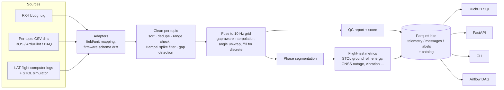
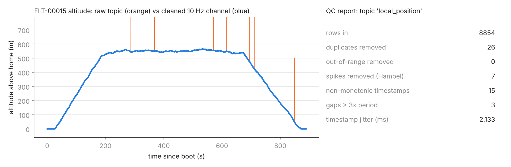

# flightlake ✈️🗄️

**A telemetry data platform for flight-test logs.** It ingests messy, multi-rate logs from the flight computer (PX4 ULog, CSV exports, LAT-style sim logs), cleans them, fuses them onto one uniform-rate schema, scores data quality, computes flight-test metrics, and serves everything through Parquet, SQL (DuckDB) and a REST API.

It is the foundation for the other four repos in this portfolio:

| Repo | What it adds on top of `flightlake` |
|---|---|
| **flightlake** (this) | ingest → clean → index → query, plus a hybrid-electric STOL simulator with fault injection |
| [aerosig](https://github.com//aerosig) | self-supervised Transformer for fault detection and a fault-signature library |
| [flight-llm-debrief](https://github.com//flight-llm-debrief) | LoRA fine-tuned LLM that reads log digests and writes grounded debriefs |
| [flight-investigator-agent](https://github.com//flight-investigator-agent) | multi-agent root-cause investigator over MCP tools |
| [aerolabel](https://github.com//aerolabel) | weak-supervision labeling, video↔telemetry sync, Streamlit explorer |



## Why this exists

Flight-test data arrives in rough shape. Every topic is logged at its own rate. Timestamps jitter and sometimes run backwards. The SD-card writer duplicates rows, and links drop out. Firmware updates rename fields and change units (one firmware version here logs battery current in centi-amps). Before anyone can train a model or answer *"what was the ground roll on sortie 112?"*, those logs need to be turned into a dataset that is **clean, uniform, documented, and queryable**. That is the job of `flightlake`.



*Spikes are removed, gaps and duplicates are counted, and the timestamp jitter is measured. The whole report is stored with the flight. Regenerate with `python scripts/plot_cleaning.py --raw data/raw/FLT-00015`.*

## Features

- **Adapters** for PX4 ULog (tested on real PX4 sample logs; topic and field candidates cover several PX4 generations), generic per-topic CSV directories (YAML mapping; an example for the CMU ALFA fault dataset is included), and LAT-style flight-computer logs.
- **A canonical schema** of 35 channels in fixed SI units ([`schema.py`](src/flightlake/schema.py)), with physical bounds and an interpolation policy for each channel.
- **Cleaning that flags rather than hides.** Every duplicate, out-of-range sample, spike and gap is counted in a per-flight QC report and rolled up into a `qc_score`. Interpolation is gap-aware: gaps longer than 1 s stay NaN.
- **Hampel spike filter with physical floors.** It removes isolated glitches but keeps genuine step changes; a motor failing is a step, not a spike.
- **Phase segmentation** into taxi, takeoff roll, climb, cruise, descent, approach and landing rollout.
- **Flight-test metrics** chosen for a hybrid-electric STOL: takeoff and landing ground roll, lift-off airspeed, time to cruise, battery and generator energy, minimum voltage and peak temperature, GNSS outage seconds, peak EKF innovation, elevator tracking RMSE, and motor RPM imbalance.
- **Lake layout:** partitioned Parquet (zstd, float32 for sensor data) plus a JSON summary for each flight with full lineage (source hash, adapter, schema version). Ingestion is idempotent: unchanged logs are skipped.
- **Query layer:** DuckDB views (`flights`, `telemetry`, `messages`, `labels`), a read-only SQL guard that is safe to expose to LLM agents, a FastAPI service and a CLI.
- **Hybrid-electric STOL simulator** (`flightlake.sim`). It models four DEP motors, a battery with a range-extender generator, GNSS/EKF health, turbulence, closed-loop autopilot and **8 injectable fault modes**, which propagate through the control loop. It writes deliberately messy raw logs, so ground truth is known and every downstream model can be scored.

| Fault mode | How it shows up (emergent, not scripted) |
|---|---|
| `motor_failure` | one RPM channel drops to 0 → throttle rises, yaw transient, roll trim offset |
| `pitot_blockage` | indicated airspeed decays → autopilot adds throttle and pitches down until synthetic airspeed takes over |
| `elevator_stuck` | elevator position freezes → pitch-via-thrust fallback, phugoid-like altitude oscillation |
| `gnss_jamming` | satellites lost, HDOP 99, EKF horizontal accuracy grows (dead reckoning) |
| `gnss_spoofing` | satellites look *healthy* while EKF position innovations ramp up, then GPS is rejected |
| `battery_degradation` | internal resistance rises and OCV drops → voltage sag under load, heating |
| `generator_dropout` | range-extender output goes to 0 → battery carries the full load, SOC falls |
| `imu_vibration` | vibration metric and accelerometer noise rise by 3–7× |

## Results on the reference fleet

`make data` simulates **300 sorties** (63.1 flight hours, 69 % with an injected fault, 9 % on a legacy firmware with a different battery schema) and ingests them:

| | |
|---|---|
| raw logs (11 topics/flight, CSV) | 1.6 GB |
| lake (Parquet, zstd) | **389 MB (4.2× smaller)** |
| fused telemetry rows (10 Hz) | 2.30 M |
| ingest time, 300 flights, 2 CPU cores | **40 s** |
| phase segmentation vs simulator ground truth | **92.4 % mean sample accuracy** (heuristic; `aerolabel` learns a better one) |
| QC score, min / mean | 85.3 / 90.4 |
| real PX4 ULog sample (`tests/data`) | ingested, 14 / 35 channels mapped |

## Quickstart

```bash
git clone https://github.com/<you>/flightlake && cd flightlake
pip install -e ".[dev]"
make test                     # 11 tests: sim, cleaning, adapters (incl. real PX4 log), SQL guard, API

flightlake simulate --n 300 --out data/raw --workers 4      # or drop real .ulg files in data/raw
flightlake ingest data/raw --lake data/lake --workers 4
flightlake show FLT-00012 --lake data/lake                    # QC + metrics + phase timeline
flightlake query "select injected_faults, avg(takeoff_ground_roll_m) from flights group by 1" --lake data/lake
flightlake serve --lake data/lake                             # http://localhost:8000/docs
```

Python:

```python
from flightlake import Lake
lake = Lake("data/lake")
tel = lake.telemetry("FLT-00012", ["airspeed_mps", "groundspeed_mps", "throttle"], t0=200, t1=400)
lake.sql("""
  select f.flight_id, max(t.ekf_pos_innov_m) as max_innov
  from telemetry t join flights f using (flight_id)
  where f.firmware = 'lat-fc 2.3.1' group by 1 order by 2 desc limit 5""")
```

Ingest real PX4 logs (for example from [review.px4.io](https://review.px4.io)) or a CSV dataset:

```bash
flightlake ingest path/to/log.ulg --lake data/lake
flightlake ingest path/to/alfa_sequence_dir --adapter csvdir --mapping configs/alfa_mapping.example.yaml
```

## Deployment

**Docker / Compose** (seeds a fleet, then serves the API):
```bash
docker compose up --build        # http://localhost:8000/docs
```

**Google Cloud (Cloud Run + GCS):**
```bash
gcloud builds submit --tag REGION-docker.pkg.dev/PROJECT/flight/flightlake
gsutil -m rsync -r data/lake gs://BUCKET/lake        # or mount the bucket with Cloud Storage FUSE
gcloud run deploy flightlake --image REGION-docker.pkg.dev/PROJECT/flight/flightlake \
  --add-volume name=lake,type=cloud-storage,bucket=BUCKET --add-volume-mount volume=lake,mount-path=/data \
  --set-env-vars FLIGHTLAKE_ROOT=/data/lake --memory 2Gi --no-allow-unauthenticated
```

**Scheduled ingestion:** copy [`dags/flightlake_ingest_dag.py`](dags/flightlake_ingest_dag.py) into Airflow (or Cloud Composer). It finds new sortie logs every 15 minutes, ingests them with dynamic task mapping (idempotent), rebuilds the catalog, and reports low-QC flights.

**CI:** GitHub Actions runs lint and tests on Python 3.10–3.12 and builds the image.

## Design decisions

- **Wide uniform-rate table** rather than long format: ML windows, plots and SQL aggregations all become trivial. Raw topics stay in the source logs, and lineage points back to them.
- **10 Hz default grid.** Enough for flight dynamics and fault signatures; the rate is configurable per ingest, and high-rate IMU analysis should read raw topics.
- **Ground truth kept separate** (`labels/`) from telemetry, so models can never accidentally train on it.
- **DuckDB over a warehouse:** zero-ops, reads Parquet in place, and fast enough for hundreds of flight hours on a laptop. The same Parquet layout loads straight into BigQuery or Spark when the fleet grows.

## Roadmap
ArduPilot DataFlash `.bin` adapter (pymavlink) · per-cell battery channels · video-frame index (see `aerolabel`) · Iceberg/Delta table format for multi-writer ingestion · Great Expectations-style contracts per airframe.

MIT licensed. The PX4 sample log in `tests/data` comes from [PX4/pyulog](https://github.com/PX4/pyulog) (BSD-3).
